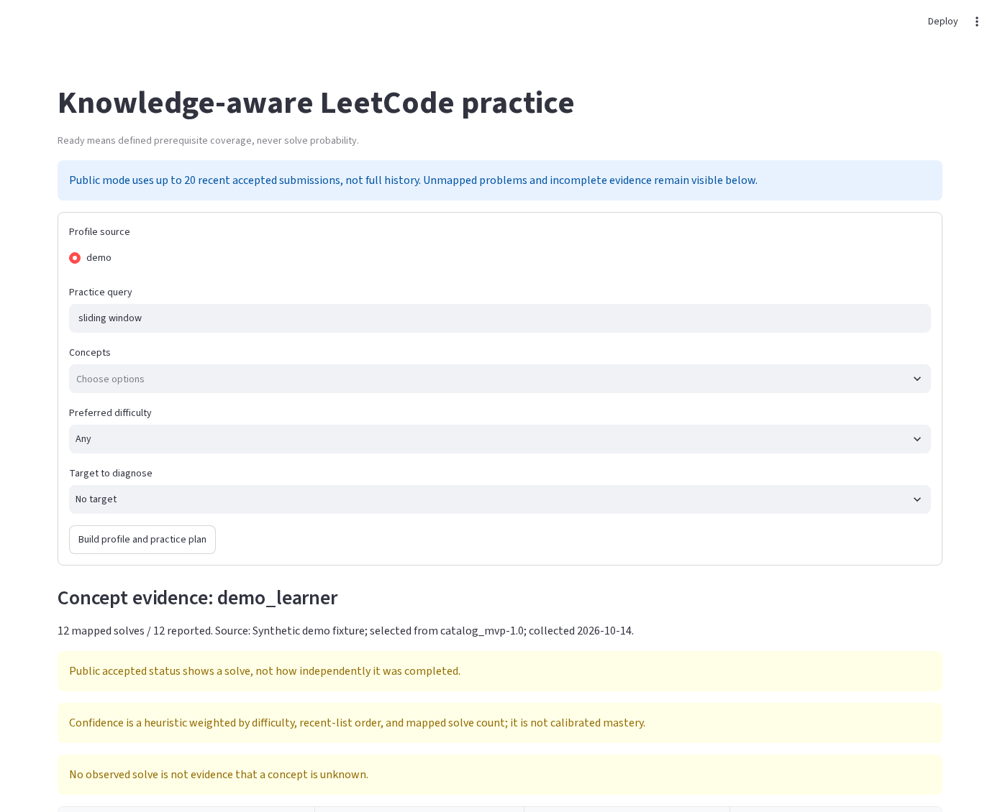
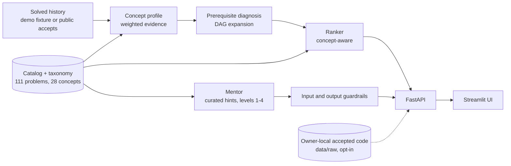

# LeetCode Knowledge-Aware Socratic Practice Mentor

[](https://github.com/sachin2967/leetcode-knowledge-system/actions/workflows/ci.yml)


A local-first practice mentor that turns a learner's solved history into concept
coverage, diagnoses missing prerequisites for a target problem, ranks what to practice
next, and gives progressive Socratic hints without handing over full solutions.

**Status:** complete local portfolio application (FastAPI + Streamlit), packaged for
trusted local use. Public hosting with personal-code access is deliberately not enabled.



*The local API and Streamlit app are running in fixture-only mode (`LKS_SERVING_MODE=demo_only`).*

## Highlights

- **28-concept prerequisite DAG** with transitive diagnosis and an ordered Easy-to-Hard
  practice path. Diagnosis explains coverage; it is not a solve-probability estimate.
- **Evidence-based learner profile:** difficulty-weighted solves with recency decay and
  noisy-OR frequency aggregation; `covered` needs two distinct solves.
- **Ranking with baselines:** tag overlap, an ID-order fallback and concept-aware
  ranking, scored with NDCG@10, Recall@5/10 and MAP on a frozen, hand-judged set.
- **Four-level curated Socratic hints** that are retrieval-grounded (curated concept
  hints, no vector index), screened by regex and Python AST/code-shape output checks.
- **Privacy boundary:** personal accepted code is opt-in, owner-keyed, stored only under
  ignored `data/raw/`, and never retrieved by the mentor.
- **Offline by default:** deterministic hints; optional local Ollama generation only.

## Results

Frozen offline checks (see `data/sample/*_report_*.json`):

| Check | Result |
| --- | --- |
| Concept-aware ranking, 3-query test split | NDCG@10 0.9564, Recall@5 0.8571, MAP 0.9045 |
| Tag-overlap baseline, same split | NDCG@10 0.8302, Recall@5 0.6905, MAP 0.7917 |
| Guardrail challenge set (authored) | 16/16 input decisions, 11/11 output decisions |
| Test suite | 68 tests |

**Read these honestly.** The ranking benchmark has six hand-judged queries (three held
out for testing). The concept-aware ranker is *given* each query's concept IDs, and the
relevance rubric is also concept-based, so this is an oracle-concept-input regression
check, not evidence of general ranking quality or of inferring concepts from text. The
"popularity" comparator is only an ID-order fallback because the catalog has no sourced
popularity snapshot. The guardrail set is a small regression check, not a safety proof.
There is no FAISS or other vector index.

## Architecture



Details: [docs/ARCHITECTURE.md](docs/ARCHITECTURE.md), [docs/BRD.md](docs/BRD.md) and the
[concept taxonomy](docs/CONCEPT_TAXONOMY.md).

## Quickstart

Requires Python 3.11 or newer.

```bash
git clone https://github.com/sachin2967/leetcode-knowledge-system.git
cd leetcode-knowledge-system
python -m venv .venv && source .venv/bin/activate      # Windows: .venv\Scripts\Activate.ps1
pip install -r requirements-dev.txt
make catalog      # rebuild catalog from the curated seed
make test         # lint + tests
make api          # http://127.0.0.1:8000/docs
make ui           # http://127.0.0.1:8501 (second terminal)
```

PowerShell equivalents:

```powershell
python -m venv .venv; .venv\Scripts\Activate.ps1
python -m pip install -r requirements-dev.txt
python -m scripts.rebuild_catalog
python -m pytest
python -m uvicorn src.api.app:app --host 127.0.0.1 --port 8000
python -m streamlit run streamlit_app/app.py --server.address 127.0.0.1 --server.port 8501
```

The rebuild validates the curated [seed](data/sample/problems_seed.psv) against the locked
taxonomy and writes the versioned [JSON export](data/sample/catalog_mvp-1.0.json) and
[SQLite store](data/sample/catalog_mvp-1.0.sqlite3). No network access or LeetCode
credentials are needed. Acceptance rates are `null` (no frozen source snapshot) and tags
are brief manual labels. The UI defaults to the loopback API; set `LKS_API_URL` to
override. In the UI, choose **demo**, target **76: Minimum Window Substring**, and submit
to see evidence, missing prerequisites and the Easy-to-Hard path. Difficulty is a ranking
preference, not a hard filter, and scores are ordering signals, not probabilities.
**public** mode fetches bounded recent public accepts once per plan and shows source,
collection date, unmapped IDs and incomplete-history uncertainty; nothing is persisted.

## API

| Endpoint | Contract |
| --- | --- |
| `GET /health` | Loaded service health |
| `GET /catalog`, `GET /concepts` | Validated catalog and locked concept IDs |
| `GET /concept-graph` | Versioned prerequisite DAG covering the 28 stable concept IDs |
| `POST /profiles` | `{ "mode": "demo" }` or `{ "mode": "public", "username": "..." }` |
| `POST /practice` | Source, query, concepts, optional difficulty/target ID, and limit (1–50); returns profile, recommendations, and optional diagnosis/path |
| `POST /mentor` | `{ "problem_id": 76, "question": "How should I start?", "level": 1 }`; returns one retrieved hint level (1–4) |
| `POST /personal/import` | Owner, explicit `owner_authorized: true`, and JSON source path relative to ignored `data/raw/`; replaces that owner's corpus |
| `POST /personal/templates` | Owner, explicit acknowledgement, and search query; returns attributed snippets or an explicit unavailable/empty/no-match state |

Example request:

```bash
curl -s -X POST http://127.0.0.1:8000/practice -H 'Content-Type: application/json' \
  -d '{"source":{"mode":"demo"},"query":"window","concepts":["sliding_window"],"target_problem_id":76,"limit":5}'
```

Invalid inputs return 422, missing catalog targets 404, missing owner acknowledgement 403, and unavailable public history 503 with a demo fallback suggestion. The UI reports connection errors if the API is stopped. Personal access is a separate opt-in form: public usernames never automatically open a corpus. Import uses an existing owner-created local JSON file; it does not upload or fetch submission code. Both services are for a trusted local machine and must stay on loopback; owner acknowledgement is not authentication for hosted multi-user use.

Mentor requests are problem-scoped. The service rejects common prompt overrides, direct full-code requests, and unrelated questions. It retrieves a curated concept hint and catalog invariant, then reveals one of four progressive levels. The output filter uses regex and Python AST/code-shape checks. These are defense-in-depth checks, not a proof against all attacks; the optional model is local-only and model/version-specific safety still requires separate review. The mentor never retrieves accepted user code.

## Docker and optional local LLM

The containerized deployment keeps host ports on loopback. From the repository root:

```powershell
Copy-Item .env.example .env
docker compose up --build -d
docker compose ps
```

Open http://127.0.0.1:8501. The API docs are at http://127.0.0.1:8000/docs. `data/raw/` is mounted for the owner's explicit local imports and remains ignored by Git. Stop with `docker compose down`; persistent personal data remains in `data/raw/`. To rebuild after source changes, rerun `docker compose up --build -d`.

The app works offline using deterministic retrieval and hint cards. For optional local generation, install and start Ollama on the same machine, pull a model supported by your hardware, then set `LKS_OLLAMA_MODEL` in `.env`. The compose default points to `host.docker.internal:11434`. Restart the stack after changing `.env`. Model-generated text is passed through the same output guardrail; if local generation is unavailable the mentor returns a recoverable error. No remote model endpoint is accepted. The adapter uses Ollama's local `/api/chat` endpoint ([API reference](https://docs.ollama.com/api/chat)).

## Isolated demo

The optional `LKS_SERVING_MODE=demo_only` profile uses fixture journeys only: personal
routes are blocked and hidden from OpenAPI, public-history requests are rejected,
and optional Ollama calls are disabled. Production mode requires this profile and a
32+ character server-side `LKS_API_KEY`; API clients use `X-API-Key`. The UI forwards
the key from its server environment and hides personal controls. Bodies are capped
at 64 KiB. `/ready` verifies catalog/taxonomy loading; `/live` checks the process.

Use `docker compose -f compose.demo.yml up --build` with the key configured. This
profile mounts no raw/personal data, and the image runs as a non-root user. Published
ports remain loopback-only; external TLS/access controls and rate limits are still
required. The default `trusted_local` mode preserves owner-authorized local imports
and is refused in production mode. See the BRD scope amendment for the boundary.

## Build a concept profile

```powershell
python -m scripts.build_profile --demo
python -m scripts.build_profile --username lee215
```

Demo mode reads the [synthetic solved fixture](data/sample/demo_solved_mvp-1.json) and requires no network. Username mode makes one public GraphQL request and prints a profile without storing the learner's history. The public endpoint currently exposes recent accepted submissions and a total count, not a full solved-problem list or solve timestamps. Recent list order is used as a recency proxy. Concept evidence combines difficulty-weighted solves with a recency decay and noisy-OR frequency aggregation; `covered` also requires two distinct solves. Confidence is a heuristic score, not a mastery or solve probability. Supporting problem IDs and uncertainty are returned with every profile. See [profile decisions](docs/ARCHITECTURE.md) for limitations.

## Rank recommendations and evaluate offline

```powershell
python -m scripts.evaluate_ranking
```

The ranker supports query-based recommendations and easier-to-harder practice paths. The evaluation uses six fixed queries, a versioned 111-problem candidate catalog, hand-graded relevance (0–2), and fixed train/test query splits. It reports NDCG@10, Recall@5, Recall@10, and MAP for tag overlap, the ID-order fallback, and concept-aware ranking in [the frozen report](data/sample/ranking_report_mvp-1.json). The concept-aware method is given each query's curated concept IDs; the relevance rubric is also concept-based. Treat this strictly as a small **oracle-concept-input regression check**: it does not evaluate whether the system can infer concepts from natural-language queries or establish general ranking quality. Judgments outside the candidate pool are excluded from attainable relevance and listed per query.

The three-query test split produces NDCG@10 **0.9564**, Recall@5 **0.8571**, and MAP **0.9045** for concept-aware ranking (tag overlap: **0.8302 / 0.6905 / 0.7917**). Because the benchmark supplies the target concept IDs and judges results using those concepts, these numbers mainly check consistency of taxonomy mappings and ranking behavior when intent is already known. They are not independent ranking-quality evidence. The “popularity” comparator is only an ID-order fallback because acceptance rates are unavailable. A larger independently judged pool, query-to-concept evaluation, and sourced dated popularity snapshot are needed before asserting the BRD's baseline success criterion.

Guardrails are evaluated independently with `python -m scripts.evaluate_guardrails`. The frozen [challenge set](data/sample/guardrail_cases_v1.json) covers injection, solution requests, out-of-scope input, benign help requests, and executable-output shapes. The current report records **16/16** input decisions and **11/11** output decisions on that small authored set; it is a regression check, not a guarantee. See [the report](data/sample/guardrail_report_v1.json) for confusion counts and limitations.

## Diagnose prerequisites

`src.knowledge_profile.prerequisite_graph` defines a versioned DAG across all 28 stable taxonomy IDs. Diagnosis expands each curated target mapping through transitive prerequisites and reports evidence IDs. Only `covered` evidence meets the Ready threshold; emerging or unobserved concepts appear as gaps, and an ordered Easy-to-Hard practice path is returned. This is a coverage explanation, never a solve-probability estimate. The edges are a reviewed teaching scaffold, not universal requirements for every problem.

## Import and retrieve your accepted code (local only)

Place an owner-authorized JSON array in ignored `data/raw/` with fields `owner`, `problem_id`, `title`, `language`, `accepted`, and `code`. Call `import_accepted_code(owner, source, data_root, owner_authorized=True)` explicitly; it rejects imports outside `data/raw/`, mismatched owners, and non-accepted rows. The stored corpus goes under a SHA-256 owner-keyed directory in `data/raw/personal_corpora/`. `retrieve_templates` only reads that owner's corpus and returns `unavailable` (no corpus), `empty` (corpus has no accepted snippets), `available` (matches), or `no_matches`. This is a local opt-in boundary; it does not provide authentication for hosted multi-user use. Never put real personal submissions in Git or tests.

## Verification

`python -m pytest` covers domain behavior, API validation and error contracts, mocked
public profiles, owner isolation and import containment, and Streamlit form journeys
against the local API. Personal-code test content is synthetic. No test needs live
LeetCode responses or an installed LLM. CI runs lint, tests, both offline evaluations,
Compose validation and container smoke checks.

```bash
make test                          # ruff + pytest
python -m scripts.evaluate_ranking
python -m scripts.evaluate_guardrails
```

The API image also passed a non-root, network-isolated fixture-only serving check. None
of this establishes cloud availability or model safety.

## Limitations

- Ranking evidence is small, hand-judged and oracle-concept-input; it is not general
  ranking quality.
- Public history exposes only recent accepts and a total count, so profiles are
  incomplete and recency is a proxy from list order.
- The prerequisite DAG is a reviewed teaching scaffold, not a universal requirement.
- Guardrails are defense in depth, not a guarantee; optional local models need their
  own safety review.
- Both services are for a trusted local machine. Owner acknowledgement is not
  authentication for hosted multi-user use.
- No active users, production hosting or measured popularity-baseline win is claimed.

## Project status

| Capability | Status |
| --- | --- |
| Catalog and 28-concept taxonomy | Complete |
| Profiles from public history and demo fixture | Complete |
| Frozen ranking and guardrail evaluations | Complete (small, scoped) |
| Prerequisite diagnosis and practice paths | Complete |
| Opt-in local accepted-code retrieval | Complete, local only |
| FastAPI and Streamlit | Complete, local only |

Scope and taxonomy changes should be recorded in the docs before code changes; see
[AGENTS.md](AGENTS.md).

## License

MIT. See [LICENSE](LICENSE).
