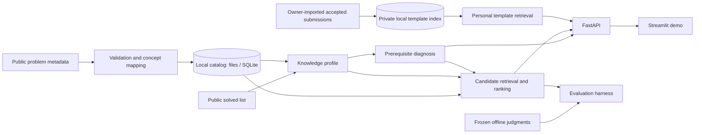

# Architecture and locked technical decisions

**Status:** design contract; no application logic is implemented yet.

**Source:** Project 1, master BRD Version 2.0 (12 October 2026), with the session's stack choice fixed below.

## Planned flow

The diagram shows intended data flow, not completed services. Query-based recommendation and concept-gap recommendation share the catalog and ranker. The prerequisite module compares a target's required concepts with the learner profile; it should state evidence and missing concepts, without interpreting the result as a success probability. Retrieval may show only the owner's imported templates and must handle an empty import gracefully.

## Locked stack

| Layer | Choice | Reason |
| --- | --- | --- |
| API and backend orchestration | Python 3.11+, FastAPI | Typed, inspectable endpoints with low setup cost |
| Ranking and tabular processing | pandas, NumPy, scikit-learn | Transparent baselines, feature work, and reproducible offline experiments |
| Semantic features, if justified | Lightweight embeddings | Add only after baseline evaluation; keep core ranking inspectable |
| MVP persistence | Local files, SQLite, JSON | Reproducible demo without managed infrastructure |
| Demo UI | Streamlit | Small Python-only interface for interview walkthroughs |
| Tests | pytest | Simple automated checks and regression tests |

Node.js, heavy React, a mandatory vector database, and cloud infrastructure are excluded from MVP. FAISS/Chroma/pgvector appear as study options in the master BRD, not required dependencies for this MVP. A local index can be chosen later if template volume warrants it.

## Component contracts

| Directory | Responsibility | Main boundary |
| --- | --- | --- |
| `src/data/` | Ingest, validate, and persist catalog and profile inputs | Preserve provenance and stable problem IDs; isolate raw imports. |
| `src/knowledge_profile/` | Solved-history concept evidence and prerequisite coverage | Explain confidence; do not infer skill solely from absence of a solve. |
| `src/ranking/` | Candidate retrieval, baselines, ranking, practice paths | Produce reproducible scores and human-readable reasons. |
| `src/evaluation/` | Judgments, metrics, comparisons, failure analysis | Keep held-out evaluation data and metrics independent of ranker tuning. |
| `src/api/` | Request validation and response contracts | Separate transport from ranking and profile logic. |
| `streamlit_app/` | Demo/username flows and results | Call the API; avoid duplicating business logic. |
| `scripts/` | Explicit import and offline evaluation commands | Never silently fetch or overwrite user data. |

## Decision record

1. **Taxonomy first.** Use the 28 IDs in [CONCEPT_TAXONOMY.md](CONCEPT_TAXONOMY.md) for all MVP labels. Later changes require an explicit version and migration plan.
2. **Public list for profile, opt-in code for templates.** A public profile does not imply access to submissions.
3. **Prerequisite coverage has narrow meaning.** “Ready” is an explanation of recorded concept coverage, not a calibrated prediction.
4. **Baseline before sophistication.** Freeze evaluation data and measure tag overlap and popularity before embedding features or learning to rank.
5. **Local-first storage.** Persist safe catalog and demo data locally; keep personal code and raw imports untracked.

The BRD's implementation schedule is sequenced as metadata/taxonomy, profile, ranking/evaluation, diagnosis, personal retrieval, then API/UI and documentation. This foundation commit intentionally stops before those implementations.
