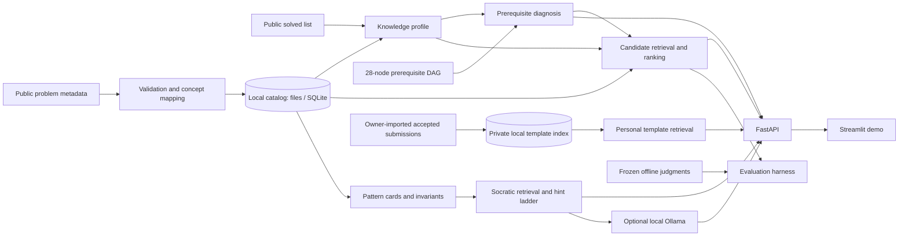

# Architecture and locked technical decisions

**Status:** Scope amendment adds the 28-node prerequisite DAG, retrieval-grounded Socratic mentor, optional local Ollama generation, input/output guardrails, guardrail evaluation, and loopback-only container deployment to the completed M1–M6 workflows.

**Source:** project requirements (BRD v2.0, 12 October 2026), with the stack choice fixed below.

## Data flow

The diagram shows implemented local data flow. Query-based recommendation and concept-gap recommendation share the catalog and ranker. The prerequisite module compares a target's required concepts with the learner profile and states evidence and missing concepts, without interpreting the result as a success probability. Retrieval shows only the explicitly selected owner's imported templates and handles an empty import gracefully.

## Locked stack

| Layer | Choice | Reason |
| --- | --- | --- |
| API and backend orchestration | Python 3.11+, FastAPI | Typed, inspectable endpoints with low setup cost |
| Ranking and tabular processing | pandas, NumPy, scikit-learn | Transparent baselines, feature work, and reproducible offline experiments |
| Semantic features, if justified | Lightweight embeddings | Add only after baseline evaluation; keep core ranking inspectable |
| MVP persistence | Local files, SQLite, JSON | Reproducible demo without managed infrastructure |
| Demo UI | Streamlit | Small Python-only interface for interview walkthroughs |
| Tests | pytest | Simple automated checks and regression tests |

Node.js, heavy React, a mandatory vector database, and cloud infrastructure are excluded from MVP. FAISS/Chroma/pgvector appear as study options in the BRD, not required dependencies for this MVP. A local index can be chosen later if template volume warrants it.

## Component contracts

| Directory | Responsibility | Main boundary |
| --- | --- | --- |
| `src/data/` | Ingest, validate, and persist catalog and profile inputs | Preserve provenance and stable problem IDs; isolate raw imports. |
| `src/knowledge_profile/` | Solved-history concept evidence and prerequisite coverage | Explain confidence; do not infer skill solely from absence of a solve. |
| `src/ranking/` | Candidate retrieval, baselines, ranking, practice paths | Produce reproducible scores and human-readable reasons. |
| `src/evaluation/` | Judgments, metrics, comparisons, failure analysis | Keep held-out evaluation data and metrics independent of ranker tuning. |
| `src/api/` | Request validation and response contracts | Separate transport from ranking and profile logic. |
| `streamlit_app/` | Demo/username flows and results | Call the API; avoid duplicating business logic. |
| `scripts/` | Explicit import and offline evaluation commands | Never silently fetch or overwrite user data. |

## Decision record

1. **Taxonomy first.** Use the 28 IDs in [CONCEPT_TAXONOMY.md](CONCEPT_TAXONOMY.md) for all MVP labels. Later changes require an explicit version and migration plan.
2. **Public list for profile, opt-in code for templates.** A public profile does not imply access to submissions.
3. **Prerequisite coverage has narrow meaning.** “Ready” is an explanation of recorded concept coverage, not a calibrated prediction.
4. **Baseline before sophistication.** Freeze evaluation data and measure tag overlap and popularity before embedding features or learning to rank.
5. **Local-first storage.** Persist safe catalog and demo data locally; keep personal code and raw imports untracked.
6. **Socratic scope amendment.** Pattern cards and catalog invariants are retrieved locally. Deterministic hints work offline; optional Ollama generation is local-only. Input validation blocks common prompt overrides, direct solution requests, and out-of-domain questions. Generated output is screened before it can leave the mentor.
7. **Reviewed prerequisite scaffold.** `concept-dag-1` maps exactly the 28 frozen taxonomy IDs. Diagnosis recursively expands prerequisites. The graph is educational guidance and requires human review, not a universal dependency model.
8. **Container boundary.** Docker Compose maps both API and UI ports to host loopback and persists owner imports in ignored `data/raw/`. The container processes listen on their internal interfaces for port forwarding; this is not permission to expose ports publicly.

The BRD's implementation schedule is sequenced as metadata/taxonomy, profile, ranking/evaluation, diagnosis, personal retrieval, then API/UI and documentation. The local implementation now covers all six delivery milestones; evaluation success remains unproven.

## Milestone 2 profile decisions and source limitation

The demo's accepted IDs are a synthetic, versioned fixture. For a public username, the currently accessible LeetCode GraphQL fields provide a total accepted count and a bounded recent accepted submission list, not a complete historical list of problem IDs. This limits the BRD's public solved-list journey: a live profile may have little or no mapped evidence for a learner whose recent solves fall outside the 100-problem local catalog. The profile explicitly reports when observed IDs are fewer than the public total. No absence is interpreted as inability; this limitation must remain visible in later API and UI work.

Recent accepted title slugs are matched to normalized local catalog titles. Unknown slugs remain reported as unmapped. This is a best-effort join until a stable public frontend ID can be retrieved for each submission; it never invents a concept mapping. The fetcher requests no private submission code or credentials and does not persist live history.

Each distinct mapped accepted problem contributes difficulty-weighted evidence to every curated concept. Easy, Medium, and Hard contribute 0.40, 0.50, and 0.60 respectively, multiplied by a recency factor `0.5 + 0.5 * exp(-rank / 10)` where rank zero is the most recent available accepted solve. Evidence combines as noisy-OR; `covered` requires at least two solves and confidence >=0.55, `emerging` is any observed evidence below that threshold, and no solve is `unobserved`. Scores are heuristics, not calibrated mastery or success probabilities. The public source provides only bounded recent accepts; older history and dates are unavailable. Multi-concept mappings and helped solves can overstate familiarity; sparse public history understates evidence.

## Milestone 3 ranking and evaluation decisions

`data/sample/ranking_judgments_mvp-1.json` freezes six query definitions, the versioned catalog candidate pool, 0–2 manual relevance grades, and query-level train/test assignments before evaluation output is written. Some judged IDs are outside the catalog; they remain in the fixture and are disclosed per query but excluded from attainable relevance. The ranker does not read judgment grades. `scripts/evaluate_ranking.py` reports the held-out split using the same candidate set for tag overlap, an explicitly named `id_order_fallback`, and concept-aware ranking. Metrics are implemented separately in `src/evaluation/metrics.py`; higher relevance grades receive exponential gain for NDCG, while Recall@5, Recall@10 and MAP treat any positive in-pool grade as relevant.

The catalog has no frozen acceptance-rate/popularity snapshot (`acceptance_rate` is null), so the current comparator is a deterministic problem-ID order. It is not a popularity baseline and must be replaced by sourced, dated popularity data before making a BRD-level baseline claim. The six-query set is intentionally small; results are descriptive, not general ranking-quality evidence. Judgments are held in a fixture separate from ranker code, but both rely on human-maintained catalog metadata, which can itself be wrong.

## Milestones 4–5 diagnosis and personal retrieval

Diagnosis uses a reviewed target-ID map plus the transitive closure of the versioned 28-node concept DAG in `src/knowledge_profile/prerequisite_graph.py`. It compares stable taxonomy IDs against profile evidence; the `covered` status alone satisfies Ready. Emerging and unobserved evidence are returned with supporting IDs and become practice gaps. The graph is a teaching scaffold rather than a universal prerequisite truth.

Personal accepted code is imported only by an explicit call with `owner_authorized=True`. The source must be under ignored `data/raw/`; rows must identify the same owner and be marked accepted. The private corpus is stored beneath a SHA-256-derived owner directory and retrieval validates owner attribution before returning snippets. This boundary is local and opt-in; it is not multi-user authentication or hosted authorization. Missing corpus, empty corpus, and no search match have separate states. No real private code is present in fixtures or tests.

## Milestone 6 transport and demo

`src/api/app.py` loads validated taxonomy and SQLite snapshots at startup. Strict Pydantic request models reject extra fields, unknown modes, invalid usernames, invalid difficulty, and unbounded limits. Existing domain dataclasses define response schemas in OpenAPI. `/profiles` builds a demo or public profile; `/practice` returns profile, query recommendations, and optional target diagnosis/path using one history fetch. Unknown concept IDs and targets are rejected before any public I/O. Sync handlers run blocking public requests in FastAPI's worker thread pool; upstream timeouts become a recoverable 503. No live history is persisted or cached by the API.

`streamlit_app/app.py` is an HTTP-only client. It displays evidence, supporting IDs, uncertainty, source dates, recommendation reasons, prerequisite coverage, and ordered gap practice. Public mode is explicitly submitted and retains the bounded-history warning. One plan result stays in Streamlit session state until replaced; a failed submission clears the previous result. Personal results are not cached in application state.

Personal import and retrieval have separate endpoints and an owner acknowledgement required for both. Import accepts only a relative path beneath ignored `data/raw/`, delegates resolved-path containment and owner validation to the existing importer, and replaces the owner's corpus. Public username selection never implies personal-code authorization. This is a trusted local workflow; both services bind to loopback in the documented commands. Authentication, remote hosting, concurrent import coordination, and production upload controls remain outside this milestone.

The owner explicitly amended scope on 22 November 2026, as recorded in [the BRD](BRD.md). Frozen ranking judgments include relevance IDs outside the catalog candidate pool; they remain unchanged and are excluded from attainable relevance in reported metrics, with affected IDs disclosed per query. Acceptance rates are unavailable, so the ID-order comparator is not a genuine popularity baseline. The BRD ranking criterion remains unproven until a larger, reconciled pool and sourced popularity snapshot are available.

## Production considerations (out of MVP)

The optional isolated `demo_only` profile is documented in the BRD amendment.
It exposes only fixture-based journeys behind an operator API key in production
mode. Personal routes are blocked before request handling, removed from OpenAPI,
and absent from its UI. Public history fetching and local model calls are disabled.
Use `compose.demo.yml`, which has no personal-data mounts; never publish the trusted
local profile. `/ready` verifies that catalog and taxonomy startup completed;
`/live` only reports process liveness. External TLS and rate limits are still required.

These are deployment decisions to revisit after the local MVP meets its evaluation criteria; they do not add requirements to the current build.

- **Public profile access:** Cache fetched solved lists with an explicit expiry, respect upstream rate limits and terms, and show when cached data may be stale. Use bounded retries and a clear unavailable state when LeetCode cannot be reached.
- **Reliable hosting:** Choose a host only after checking uptime, persistent storage, resource limits, and cost. Hugging Face Spaces, Azure student credits, and a small always-on instance are candidates, not locked choices. Any ephemeral host needs a deliberate plan for SQLite files and imported submissions.
- **Frontend evolution:** A React client could later consume the same FastAPI contracts if the demo warrants it. Streamlit remains the MVP UI; a second frontend must not duplicate profile or ranking logic.
- **Multi-user security:** Hosting private imports for multiple users requires authentication, authorization on every read/write, per-user storage isolation, retention/deletion controls, and secret management before launch. This capability is deferred from the MVP.
