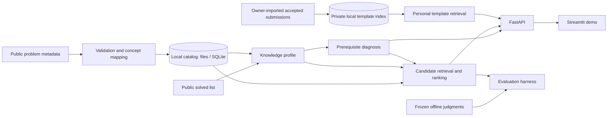

# Architecture and locked technical decisions

**Status:** Milestones 1–5 provide the catalog, evidence-based profiles, explainable ranking/evaluation, prerequisite diagnosis, and local owner-scoped personal retrieval. API and UI remain planned.

**Source:** Project 1, master BRD Version 2.0 (12 October 2026), with the session's stack choice fixed below.

## Planned flow

The diagram shows intended data flow, not completed services. Query-based recommendation and concept-gap recommendation share the catalog and ranker. The prerequisite module compares a target's required concepts with the learner profile; it should state evidence and missing concepts, without interpreting the result as a success probability. Retrieval may show only the owner's imported templates and must handle an empty import gracefully.

## Locked stack

| Layer | Choice | Reason |
| --- | --- | --- |
| API and backend orchestration | Python 3.11+, FastAPI | Typed, inspectable endpoints with low setup cost |
| Ranking and tabular processing | pandas, NumPy, scikit-learn | Transparent baselines, feature work, and reproducible offline experiments |
| Semantic features, if justified | Lightweight embeddings | Add only after baseline evaluation; keep core ranking inspectable |
| MVP persistence | Local files, SQLite, JSON | Reproducible demo without managed infrastructure |
| Demo UI | Streamlit | Small Python-only interface for interview walkthroughs |
| Tests | pytest | Simple automated checks and regression tests |

Node.js, heavy React, a mandatory vector database, and cloud infrastructure are excluded from MVP. FAISS/Chroma/pgvector appear as study options in the master BRD, not required dependencies for this MVP. A local index can be chosen later if template volume warrants it.

## Component contracts

| Directory | Responsibility | Main boundary |
| --- | --- | --- |
| `src/data/` | Ingest, validate, and persist catalog and profile inputs | Preserve provenance and stable problem IDs; isolate raw imports. |
| `src/knowledge_profile/` | Solved-history concept evidence and prerequisite coverage | Explain confidence; do not infer skill solely from absence of a solve. |
| `src/ranking/` | Candidate retrieval, baselines, ranking, practice paths | Produce reproducible scores and human-readable reasons. |
| `src/evaluation/` | Judgments, metrics, comparisons, failure analysis | Keep held-out evaluation data and metrics independent of ranker tuning. |
| `src/api/` | Request validation and response contracts | Separate transport from ranking and profile logic. |
| `streamlit_app/` | Demo/username flows and results | Call the API; avoid duplicating business logic. |
| `scripts/` | Explicit import and offline evaluation commands | Never silently fetch or overwrite user data. |

## Decision record

1. **Taxonomy first.** Use the 28 IDs in [CONCEPT_TAXONOMY.md](CONCEPT_TAXONOMY.md) for all MVP labels. Later changes require an explicit version and migration plan.
2. **Public list for profile, opt-in code for templates.** A public profile does not imply access to submissions.
3. **Prerequisite coverage has narrow meaning.** “Ready” is an explanation of recorded concept coverage, not a calibrated prediction.
4. **Baseline before sophistication.** Freeze evaluation data and measure tag overlap and popularity before embedding features or learning to rank.
5. **Local-first storage.** Persist safe catalog and demo data locally; keep personal code and raw imports untracked.

The BRD's implementation schedule is sequenced as metadata/taxonomy, profile, ranking/evaluation, diagnosis, personal retrieval, then API/UI and documentation. The repository has completed the catalog, profile, and first ranking/evaluation steps.

## Milestone 2 profile decisions and source limitation

The demo's accepted IDs are a synthetic, versioned fixture. For a public username, the currently accessible LeetCode GraphQL fields provide a total accepted count and a bounded recent accepted submission list, not a complete historical list of problem IDs. This limits the BRD's public solved-list journey: a live profile may have little or no mapped evidence for a learner whose recent solves fall outside the 100-problem local catalog. The profile explicitly reports when observed IDs are fewer than the public total. No absence is interpreted as inability; this limitation must remain visible in later API and UI work.

Recent accepted title slugs are matched to normalized local catalog titles. Unknown slugs remain reported as unmapped. This is a best-effort join until a stable public frontend ID can be retrieved for each submission; it never invents a concept mapping. The fetcher requests no private submission code or credentials and does not persist live history.

Each distinct mapped accepted problem contributes one evidence item to every concept curated for that problem. One solve is `emerging` with an evidence score of 0.5; two or more are `covered` with score 1.0; no solve is `unobserved` with score 0. These scores are transparent thresholds, not calibrated mastery or success probabilities. Multi-concept mappings and helped solves can overstate familiarity; sparse public history understates evidence. The profile includes the supporting problem IDs and uncertainty notes.

## Milestone 3 ranking and evaluation decisions

`data/sample/ranking_judgments_mvp-1.json` freezes six query definitions, the complete versioned catalog as the candidate pool, 0–2 manual relevance grades, and query-level train/test assignments before any evaluation output is written. The ranker does not read judgment grades. `scripts/evaluate_ranking.py` reports the held-out split using the same candidate set for tag overlap, a popularity fallback, and concept-aware ranking. Metrics are implemented separately in `src/evaluation/metrics.py`; higher relevance grades receive exponential gain for NDCG, while Recall@10 and MAP treat any positive grade as relevant.

The catalog has no frozen acceptance-rate/popularity snapshot (`acceptance_rate` is null), so the current popularity comparator is a deterministic problem-ID order. It is not a genuine popularity baseline and must be replaced by sourced, dated popularity data before making a BRD-level baseline claim. The six-query test set is intentionally small; the recorded comparison is an initial offline check, not a general ranking-quality claim. Judgments are held in a fixture separate from ranker code, but both rely on human-maintained catalog metadata, which can itself be wrong.

## Milestones 4–5 diagnosis and personal retrieval

Diagnosis uses a small explicit target-ID prerequisite map in `src/knowledge_profile/diagnosis.py`, with catalog concepts as a fallback for unmapped targets. It compares only stable taxonomy IDs against profile evidence; the `covered` status alone satisfies Ready. Emerging and unobserved evidence are returned with supporting IDs and become practice gaps. The path reuses deterministic concept matching and Easy-to-Hard ordering. This is a compact MVP mapping, not a full prerequisite graph.

Personal accepted code is imported only by an explicit call with `owner_authorized=True`. The source must be under ignored `data/raw/`; rows must identify the same owner and be marked accepted. The private corpus is stored beneath a SHA-256-derived owner directory and retrieval validates owner attribution before returning snippets. This boundary is local and opt-in; it is not multi-user authentication or hosted authorization. Missing corpus, empty corpus, and no search match have separate states. No real private code is present in fixtures or tests.

## Production considerations (out of MVP)

These are deployment decisions to revisit after the local MVP meets its evaluation criteria; they do not add requirements to the current build.

- **Public profile access:** Cache fetched solved lists with an explicit expiry, respect upstream rate limits and terms, and show when cached data may be stale. Use bounded retries and a clear unavailable state when LeetCode cannot be reached.
- **Reliable hosting:** Choose a host only after checking uptime, persistent storage, resource limits, and cost. Hugging Face Spaces, Azure student credits, and a small always-on instance are candidates, not locked choices. Any ephemeral host needs a deliberate plan for SQLite files and imported submissions.
- **Frontend evolution:** A React client could later consume the same FastAPI contracts if the demo warrants it. Streamlit remains the MVP UI; a second frontend must not duplicate profile or ranking logic.
- **Multi-user security:** Hosting private imports for multiple users requires authentication, authorization on every read/write, per-user storage isolation, retention/deletion controls, and secret management before launch. This capability is deferred from the MVP.
